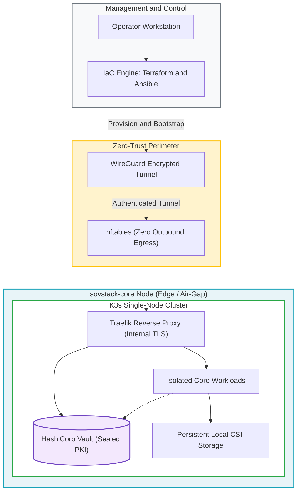

# sovstack-core

> Automated, reproducible, and sovereign edge infrastructure baseline designed for air-gapped environments.

`sovstack-core` provides a hardened, Infrastructure-as-Code (IaC) foundation for deploying and operating single-node appliances in environments where strict data isolation, zero outbound egress, and local governance are paramount (e.g., healthcare clinics, legal practices, and regulated SMEs).

This repository represents **Phase 1** of the sovStack ecosystem, establishing the declarative OS hardening, container orchestration, secret management, and network containment layer.

---

## Architecture Overview

